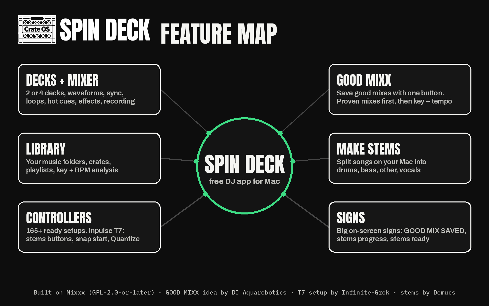
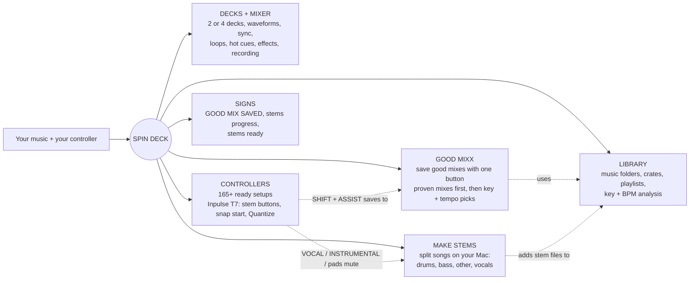

# Spin Deck feature map

| Part | What it does | How you use it |
|---|---|---|
| Decks + mixer | Play, mix, sync, loop, cue, effects, record | Mouse, keyboard or a controller |
| Library | Your music, crates, playlists, key and tempo | Preferences → Library: add your music folder |
| Controllers | 165+ ready setups; Inpulse T7 with Spin Deck extras | Preferences → Controllers: pick yours |
| GOOD MIXX | Remembers mixes that worked; suggests what's next | SHIFT + ASSIST on the T7 saves; click **GOOD MIXX** in the sidebar |
| Make Stems | Splits a song into drums, bass, other, vocals | Right-click a song → **Make Stems** |
| Signs | Big on-screen messages | Shown automatically |

Built on [Mixxx](https://mixxx.org) (GPL-2.0-or-later). GOOD MIXX idea by DJ Aquarobotics. Inpulse T7 setup by Infinite-Grok. Stems split with Demucs (MIT).
