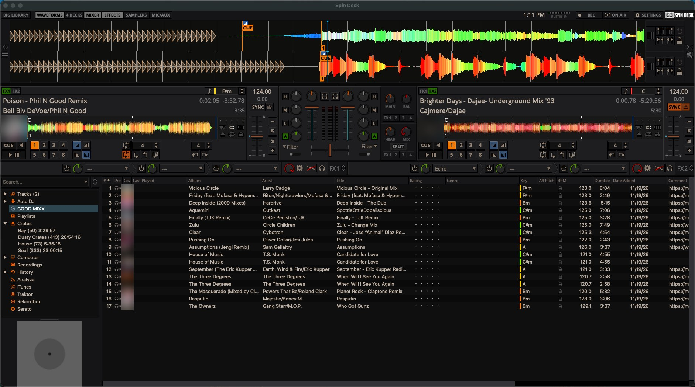

# SPIN DECK

### A free DJ app for Mac, with GOOD MIXX™ and stems built in.

From **XTRA GOOD LABS** · [**Buy me a coffee ☕**](https://buymeacoffee.com/xtragoodlabs) · [**Website & download**](https://xtragoodlabs.github.io/spin-deck) · [**Report a bug**](https://github.com/XTRAGOODLABS/spin-deck/issues/new/choose) · [**More from XTRA GOOD LABS**](https://github.com/XTRAGOODLABS)

**Feature map:** [FEATURE-MAP.md](FEATURE-MAP.md) · **Inpulse T7 control map:** [T7-MAP.md](T7-MAP.md)

Spin Deck is a DJ app from XTRAGOODLABS, part of the Crate OS family.

## Built on Mixxx

Spin Deck is built on [Mixxx](https://mixxx.org), the free and open-source DJ
software made by the Mixxx Development Team. Mixxx is licensed under the GNU
General Public License, version 2 or later, and so is Spin Deck. See
[LICENSE](LICENSE). Huge thanks to everyone who has worked on Mixxx.

## Controllers

- **Hercules DJControl Inpulse T7** (beta): motor platters, colored pads,
  effects and mixer. This setup is by Infinite-Grok
  (github.com/Infinite-Grok/mixxx-hercules-t7, GPL-2.0-or-later), and builds on
  the Inpulse 500 setup in Mixxx by Ev3nt1ne, DJ Phatso and resetreboot.

## GOOD MIXX™

Remember the mixes that work and get next-song suggestions. The GOOD MIXX idea
comes from DJ Aquarobotics.

- **Save a good mix:** on the Inpulse T7, hold SHIFT and press ASSIST on the
  deck you just mixed in. A big "GOOD MIX SAVED" sign shows on screen and that
  deck's pads flash green.
- **What's next:** click **GOOD MIXX** in the library sidebar. Under it,
  **✓ Good mixes** lists songs that already worked after the playing song, and
  **Suggestions** lists songs with a close tempo and a matching key. Clicking
  GOOD MIXX itself shows both, good mixes first.
- **Undo or bring in old mixes:** right-click **GOOD MIXX** in the sidebar.
  Spin Deck brings in the GOOD MIXX app's saved mixes the first time it starts.
- Other controllers can use `[GoodMixx],save_deck1`-`save_deck4`,
  `[GoodMixx],undo` and `[GoodMixx],saved_deck`.

## Make Stems

Split songs into drums, bass, other and vocals with the free Demucs splitter.

- Right-click one or more songs and choose **Make Stems**. The first time,
  Spin Deck asks to download the splitter (about 2-3 GB, once) into
  `~/Library/Application Support/Spin Deck/stems`. Delete that folder to remove it.
- Songs are split one at a time in the background; a sign shows progress. Each
  finished `.stem.mp4` is saved next to the song and takes the song's place in the
  library: same crates, playlists, hot cues, BPM and key. The original file is left
  on your drive and hidden from the library, so there is never a second copy to
  search for.
- On the Inpulse T7: **VOCAL** plays only the vocals, **INSTRUMENTAL** plays
  only the music (press again for everything), and pad page 3 gives one pad per stem (lit in its colour while it
  plays, dark red while muted).
- **BeatDeck**: a beat grid that plays in time with the decks.

## DJ effects

Four effects made for the FX buttons, with the main move on the effect's knob:

- **Echo Out:** a beat-timed echo. Turn the knob up and the song drops away,
  leaving only its echo to ride out on.
- **Riser:** turn the knob up for a rising noise sweep while the bass thins out.
- **Roll:** repeats a slice of the beat from the moment you press it. The knob picks
  the slice, from 1/16 to 1 beat.
- **Brake:** a turntable stop. The knob sets how long it takes, from 1/2 to 8 beats.

They come ready as two effect chains, **Spin Deck: Echo Out, Roll, Brake** and
**Spin Deck: Riser**. Pick one for an effect unit and the T7's FX buttons play them.

Your Mac's own Audio Unit plug-ins are switched off, since most are recording
tools; this also makes Spin Deck start faster.

## Skins

Four Spin Deck layouts, picked in **Preferences → Interface → Skin**:

- **Spin Deck CRATE**: the everyday layout. Waveforms on top, turntables, decks,
  mixer and library.
- **Spin Deck BOOTH**: for playing out. Huge numbers and big buttons; tap
  **LIBRARY** to show or hide the song list.
- **Spin Deck ON AIR**: for radio. Library first, big clock, mic ON AIR button
  and Auto DJ controls (Auto DJ, Fade Now, Skip).
- **Spin Deck POCKET**: a small layout for a laptop screen or a side window.

The skins are made by `packaging/spindeck/make-skins.py`; run it again after
changing it.

## Mac download

Each change builds a Mac app on GitHub. Open the **Actions** tab, pick the
latest **Spin Deck Mac Build** run, and download the Apple Silicon or Intel
version at the bottom of the page.

## Support

Spin Deck is free. If it helps your sets, you can
[buy XTRA GOOD LABS a coffee](https://buymeacoffee.com/xtragoodlabs).

The original Mixxx read-me is kept in [MIXXX-README.md](MIXXX-README.md).

GOOD MIXX™, Spin Deck™, Crate OS™ and Beatdeck™ are trademarks of XTRA GOOD LABS.
