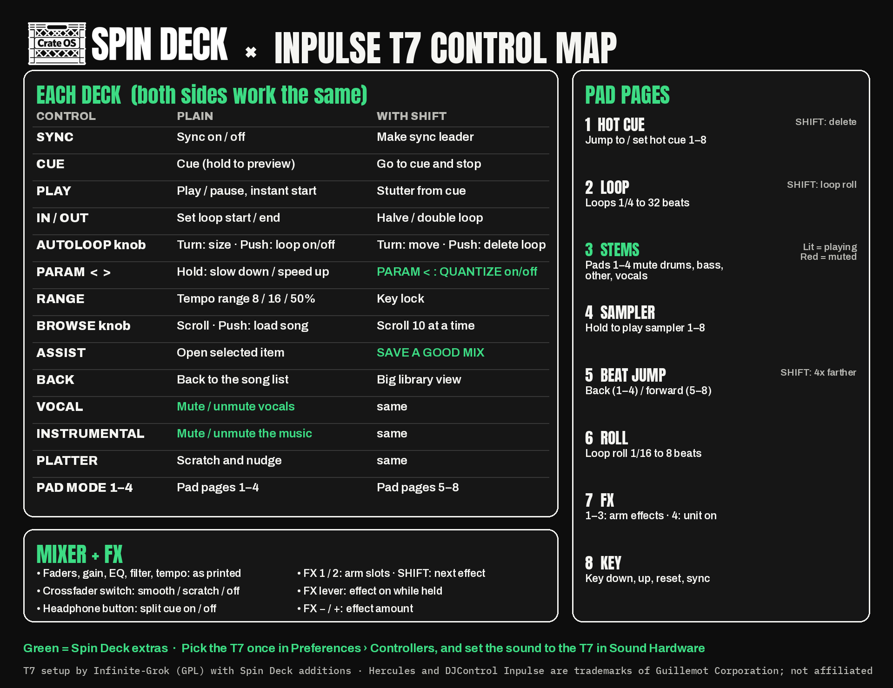

# Spin Deck × Hercules DJControl Inpulse T7: control map

**Set up once:** Preferences › Controllers › pick **DJControl Inpulse T7**, tick **Enabled**, load **Hercules DJControl Inpulse T7**. Preferences › Sound Hardware: **Main** = T7 channels 1-2, **Headphones** = T7 channels 3-4.

**Bold** = Spin Deck extras.

## Each deck (both sides work the same)

| Control | Plain | With SHIFT |
|---|---|---|
| SYNC | Sync on / off | Make sync leader |
| CUE | Cue (hold to preview) | Go to cue and stop |
| PLAY | Play / pause, **instant start** | Stutter from cue |
| IN / OUT | Set loop start / end | Halve / double loop |
| AUTOLOOP knob | Turn: loop size · Push: loop on / off | Turn: move loop · Push: delete loop |
| PARAM < / > | Hold: slow down / speed up | **PARAM <: Quantize on / off** (lamp lit = on) |
| RANGE | Tempo range 8 / 16 / 50% | Key lock |
| BROWSE knob | Scroll · Push: load song | Scroll 10 at a time |
| ASSIST | Open selected item | **Save a GOOD MIX** (this deck's song worked after the other deck's) |
| BACK | Back to the song list | Big library view |
| VOCAL | **Mute / unmute vocals** (stem files) | same |
| INSTRUMENTAL | **Mute / unmute the music** (stem files) | same |
| Platter | Scratch and nudge | same |
| Pad mode 1-4 | Pad pages 1-4 | Pad pages 5-8 |

## Pad pages

| Page | Pads | With SHIFT |
|---|---|---|
| 1 Hot cue | Jump to / set hot cue 1-8 | Delete hot cue |
| 2 Loop | Loops 1/4 to 32 beats | Loop roll |
| **3 Stems** | **Pads 1-4 mute drums, bass, other, vocals** (lit = playing, red = muted) | same |
| 4 Sampler | Hold to play sampler 1-8 | same |
| 5 Beat jump | Back (pads 1-4) / forward (5-8) 1, 2, 4, 8 beats | 4× farther |
| 6 Roll | Loop roll 1/16 to 8 beats while held | same |
| 7 FX | Pads 1-3 arm effects · pad 4 unit on while held | same |
| 8 Key | Key down, up, reset, sync | same |

## Mixer + FX

- Faders, gain, EQ, filter, tempo: as printed
- Crossfader switch: smooth / scratch / off
- Headphone button: split cue on / off
- FX 1 / 2: arm effect slots · SHIFT: load next effect
- FX lever: effect unit on while held
- FX − / +: effect amount

T7 setup by [Infinite-Grok](https://github.com/Infinite-Grok/mixxx-hercules-t7) (GPL-2.0-or-later), based on the Inpulse 500 setup by Ev3nt1ne, DJ Phatso and resetreboot, with Spin Deck additions. Hercules and DJControl Inpulse are trademarks of Guillemot Corporation; Spin Deck is not affiliated with them.
